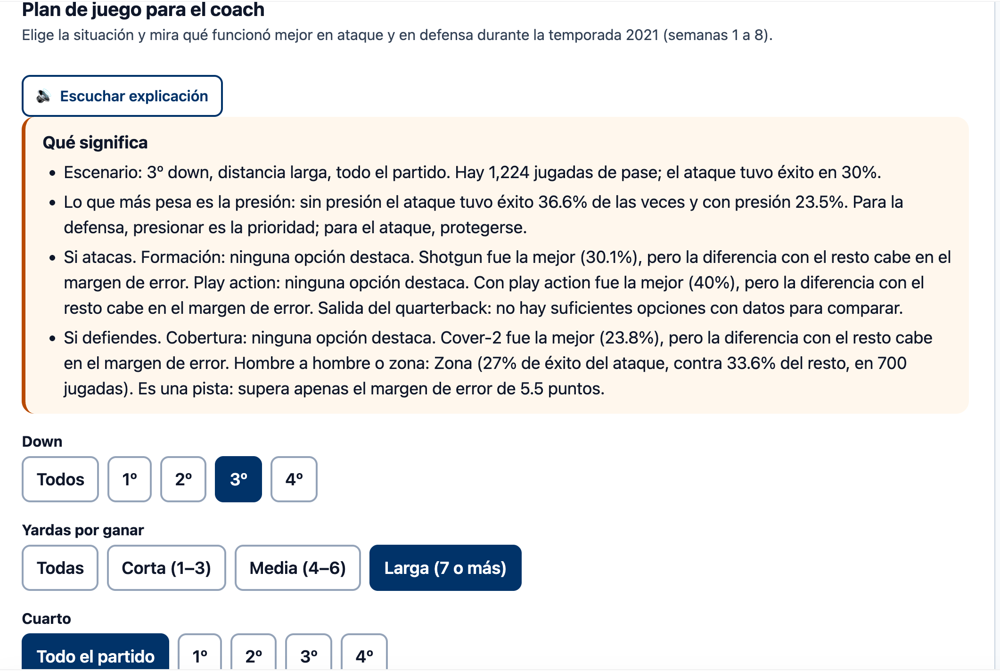

# Presión, clima y desgaste en la NFL

Construí una app web accesible que cruza 8,557 jugadas de pase de la NFL (temporada 2021, semanas 1 a 8) con la temperatura de cada partido y la velocidad de los jugadores, con un plan de juego que dice qué funcionó mejor en cada down, distancia y cuarto, y un asistente con IA (Amazon Nova) que responde solo con esos datos. Revela que la presión sobre el quarterback es lo que más pesa: sube con el down (32% en el 1er down, 45% en el 3ro), crece poco a poco durante el partido (36% en el 1er cuarto, 39% en el 4to) y, cuando ocurre, el éxito del ataque cae de 57% a 34%. El clima, en cambio, casi no cambia la presión ni la velocidad de los defensores (de 4.16 a 4.27 yardas por segundo en 30 partidos), y en el 3er cuarto solo deja una pista: más presión con calor (42%) que en domo (35%). La usarían entrenadores, scouts y comentaristas, y también aficionados neurodivergentes, personas con discapacidad y personas mayores, porque cada gráfica trae una explicación en lenguaje sencillo que se puede escuchar en voz alta, su tabla de datos y letra ajustable.

Fuentes: NFL Big Data Bowl (Next Gen Stats y PFF) y nflverse (temperatura y tipo de estadio). Los resultados muestran asociaciones, no causas.
